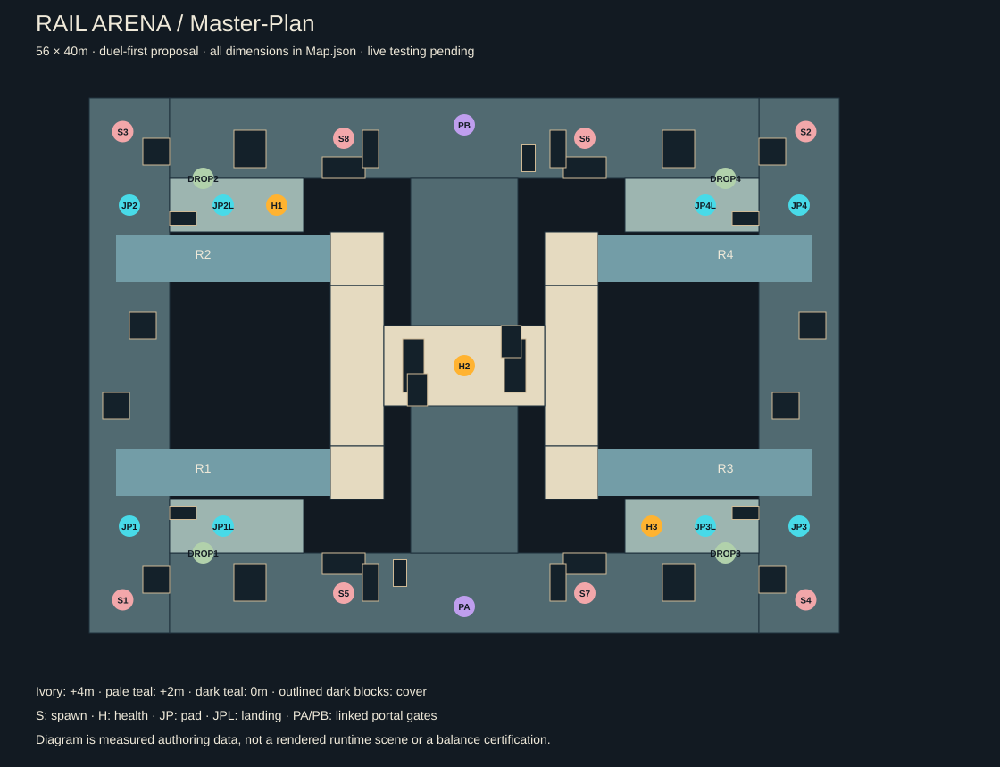

# Foundry arena v2 / measured design

Authority: [complete arena specification](../../../docs/ARENA-DESIGN.md).

This is a fully authored **layout proposal**, not approved final geometry or a runtime integration. Creator choices: duel first, flowing routes with deliberate exposure, 56 × 40m footprint, opaque shot-blocking portals. Exact placements and numerical traversal values are initial authoring targets requiring review and live testing.

| Artifact | Use |
| --- | --- |
| [Combined plan](Master-Plan.svg) | Layered structure, cover and gameplay placements |
| [Lower deck](Lower-Deck.svg) | Loop, Underpass, spawn pockets and gates |
| [Wing deck](Wing-Deck.svg) | +2m balconies, landings and wing health |
| [Upper deck](Upper-Deck.svg) | Crown, approach spines and central health |
| [East/west section at n=8](Section-EW-N8.svg) | Both ramp profiles and upper landings; vertical scale exaggerated 2× |
| [North/south section at x=0](Section-NS-X0.svg) | Underpass/bridge relationship; vertical scale exaggerated 2× |
| [Map.json](Map.json) | Named surfaces, cover, ramp profiles, spawns, pickups, pad trajectories, portals and zones |
| [Environment kit](Environment-Kit.json) | Reusable construction/cover/traversal inventory, instance counts, collision and required references |
| [Static review](Static-Review.json) | Spawn centre-ray checks and pickup/landing clearances; no gameplay certification |

Reproduce with `python tools/design_foundry_arena.py` from the repository root. The tool writes only this design package. It does not run Blender/Unity, edit gameplay scenes or generate AI artwork.

The [full reference pack](References-v1/README.md) includes the editable v2 Blender master, 22 matching geometry views, eight concept sheets, six-view cover envelopes and an offline gallery. Geometry consumes Map.json; generated artwork remains a separate review candidate. The v1 Blender master and artwork are historical.

All generation ran headlessly. Controller testing, competitive balance and creator artwork approval remain open. This revision is local and has not been published to GitHub.
