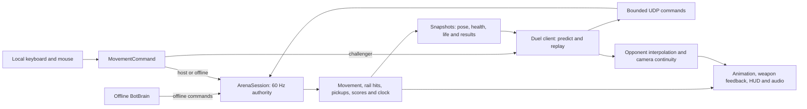

# Rail Arena

An original railgun arena shooter for Windows, inspired by Quake III Arena's movement and Unreal Tournament's readable arenas and bot combat.

**Under development. Offline play and direct-IP duel builds are available locally; this is not the complete game or a published release.**

The target is immediate offline bot matches and practice, plus direct-IP two-human duels. The complete scope and acceptance criteria are in [the objective](docs/OBJECTIVE.md).

Public source: [Evekiio/rail-arena](https://github.com/Evekiio/rail-arena). Tested development milestones are pushed as work progresses; a finished downloadable release is not available yet.


*Actual non-development Windows player from HUD milestone 94ab8a77 during native mouse firing in three-bot practice. Later rail effects and articulated-hand previews are documented separately. Glove/cuff cleanup, richer action animation and final arena polish remain unfinished. Physical keyboard acceptance remains open; software mapping has separate live tests.*

The current view rig also has original procedural run bob, look sway, landing compression, respawn raise and recoil pitch. These move the weapon and hands while preserving camera aim. See [motion details and controlled preview scope](docs/FIRST-PERSON-ARMS.md).

The [combat HUD](docs/COMBAT-HUD.md) now separates health, score/speed, rail recovery and match state, with a fixed readiness reticle and a readable scoreboard backdrop. Joining-player charge displays follow the local prediction clock.

[Combat feedback](docs/COMBAT-FEEDBACK.md) adds pooled rail core/halo, muzzle and impact effects, authoritative hit/elimination markers, damage edges and four original audio cues with editable synthesis source and WAV review exports.

[Articulated hands](docs/HAND-ARTICULATION.md) add 30 weighted finger joints, an editable fitted grip profile and a subtle trigger/support response for first- and third-person models. The controlled motion preview and contact closeups document progress and remaining surface defects.

## Project

- Unity **6000.6.7f1**, pinned in `RailArena/ProjectSettings/ProjectVersion.txt`.
- Universal Render Pipeline **17.6.0**.
- C# gameplay simulation at **60 ticks per second**.
- Local Git with LFS for binary artwork and audio.

Open the `RailArena` folder in the exact Editor version. Package versions are recorded in the manifest and lockfile. Unity licensing and the first package restore are required for development. The intended offline game will not require an account or external service.

Clone with Git LFS installed so the binary models, textures and animation sources are restored:

```powershell
git lfs install
git clone https://github.com/Evekiio/rail-arena.git
cd rail-arena
git lfs pull
```

## Current implementation

The editable Foundry arena now includes a lower loop, elevated bridge and wings, four ramps, four launch pads, three health pickups and eight spawn positions. Offline bot match and untimed practice use the same local 60 Hz authority, with configurable bot count, three difficulty levels and stationary, moving or combat targets.

The first [arena surface-art pass](docs/ARENA-ART.md) adds original panel textures, beveled covers, vents, warning markings and directional launch fields while preserving the collider/navigation signature.

The first gameplay pass includes location-based hitboxes, a rail cooldown, deaths and respawns, health restoration, countdown, time limit, void scoring and tied-leader sudden death. Menus, a HUD, scoreboard, results, restart and basic settings are implemented. Characters now use a textured armored humanoid, three mesh LODs, four palette variants, retargeted locomotion/jump/landing/hit/death animations and two-hand aiming IK. See [character sources, editing and limitations](docs/CHARACTERS.md). The original [RA-01 railgun](docs/WEAPONS.md) has editable Blender source, two mesh LODs and cooldown-driven feedback. [First-person armored arms](docs/FIRST-PERSON-ARMS.md) now share its grips and recoil. Hand/action-animation, sound and arena polish remain. **The full online acceptance criteria remain incomplete.**

Direct-IP duel integration is available from **ONLINE DUEL // DIRECT IP**. Host and join use the same build and selected UDP port, then both players ready up. The host owns gameplay, while the client predicts/reconciles movement and interpolates the opponent. Bounded 200 ms hit rewind has geometry tests and integrated UDP evidence. Automated local match/rematch and delay/loss reports identify their builds; native human interaction, reconciliation feel and a real internet path remain unverified. See [networking coverage and remaining integration](docs/NETWORKING.md).

## Validation snapshot

| Evidence | Scope |
| --- | --- |
| 76 Editor-suite tests passing | Shared simulation, model/animation, finger skin deformation and live wrist/palm alignment, bots, networking/lifecycle, HUD/input, effects and audio signals |
| 37 standalone mechanics checks passing | Accelerated real authority with actual hurtboxes; combat/pickup/respawn/match boundaries, hit/elimination feedback, solo movement/fire/respawn and mode switching |
| Full ten-minute match and rematch on life-aware build 235d7b84 | Separate clean and impaired local UDP runs; matching result tick, scores and life numbers, with zero application errors; newer presentation changes have separate regression reports |
| Replicated respawn lifecycle | Version 3 snapshots reset stale input, interpolation and view state, including missed-death and rematch regressions |
| Native mouse/settings review | Solo menu/launch, aiming/firing, sensitivity/volume save and relaunch, resolution changes and fullscreen toggle; [evidence and limits](docs/NATIVE-INPUT-REVIEW.md) |
| Human acceptance still open | Keyboard controls and mouse feel, display-mode persistence, sound-on quality, native two-human duel, release qualification and real internet path |

Reports identify their build and limitations. See [the acceptance matrix](docs/ACCEPTANCE.md), [validation record](docs/VALIDATION.md), [bot checks](docs/BOT-VALIDATION.md) and [direct-IP hosting guide](docs/HOSTING.md).

## Architecture



`RailArena.Simulation` contains movement integration and match/combat rules. Runtime authority supplies collision resolution and hit geometry; the client reuses movement and pad logic. `Networking` owns bounded codecs, the two-peer link, input queue, historical hit tracing and camera continuity. Presentation observes actor state and never grants damage or movement. Life identity separates respawn teleports from ordinary motion, clearing stale prediction and interpolation state. Online slots are human-only; automated validation supplies controls without adding an online bot mode.

## Play the local build

For the local non-development playtest, launch `Builds/NativeReviewPlayer/RailArena.exe`; its diagnostic marker has been removed. `Builds/Windows/RailArena.exe` remains the development player used by automated runners. These are unfinished local builds, not downloadable releases.

Choose **OFFLINE BOT MATCH** or **PRACTICE**. Set bot count, difficulty and target behavior before starting. During a session, press Escape to pause; changing the configuration and choosing **RESTART SESSION** applies it. Native keyboard acceptance is still open as documented above.

For movement and arena testing alone, cycle **BOTS** to **0 // SOLO**, then choose **SOLO PRACTICE // UNTIMED**. It has no opponents or network connection. Movement, rail firing, pickups, jump pads, void scoring and unlimited respawns use the normal authority. Timed bot matches require at least one bot. Solo practice can restart with bots after changing the count in the pause menu.

| Control | Action |
| --- | --- |
| W A S D | Move |
| Mouse | Aim |
| Left mouse | Fire railgun |
| Space | Jump; hold to keep hopping |
| Tab | Hold scoreboard |
| Escape | Pause and settings |

No sprint, stamina, armor or ammo pickups are used. Health is 100; headshots deal 100, body hits 50 and limb hits 34. Health pickups restore 25 and return after 20 seconds. The rail cycles every 1.5 seconds.

## Tests

With the Unity CLI installed:

```powershell
unity test .\RailArena --mode EditMode --filter RailArena.Tests --output .\Validation\editmode.xml
```

Passing simulation tests alone does not establish playability, movement fidelity, bot quality or multiplayer reliability. Standalone, visual and simulated-network validation remain required.

For the development Windows build, run `tools/Test-Offline.ps1` to execute a repeatable 45-second local combat smoke test with seven bots and an automated human input driver. It saves counters, errors, void traces and frame timing. This automation does not validate human input feel or menu clicks. Hidden-window frame timing is not a visible-window rendering benchmark.

The same runner accepts `-Duration 600 -Difficulty 0 -Bots 7` for a ten-minute easy session; difficulty values 1 and 2 select medium and hard. Per-actor route and sampled stall measurements are described in [bot validation](docs/BOT-VALIDATION.md).

Bot reaction, aim and decision profiles are editable in `Assets/Resources/BotTuning.asset`; restart the session to apply changes. See [bot tuning](docs/BOT-TUNING.md) for units, preserved defaults and validation.

Run `tools/Test-Mechanics.ps1` for 35 accelerated standalone authority checks covering actual hurtbox damage, held-fire cooldowns, pickups, respawns, void scoring, match clocks, sudden death, untimed practice and solo-to-bot mode switching. See [scenario scope and the bone-scale regression it discovered](docs/MECHANICS-VALIDATION.md). These checks do not substitute for native playtesting or real-time multiplayer.

Build the current saved scene through the running pinned Editor:

```powershell
unity command script eval --project-path .\RailArena --caller plugin --skill unity-cli --timeout 600 -- --code 'RailArena.Editor.ArenaBuilder.BuildWindows();'
```

The scene and editable tuning live under `Assets/RailArena/Generated`. `Rail Arena > Build Foundry scene` regenerates these generated assets from the builder; manual changes to generated assets should be preserved separately before regeneration. See the [direct-IP hosting, firewall and port-forwarding guide](docs/HOSTING.md) for manual connection steps and the remaining remote-network acceptance.

For a non-development local playtest build, use `ArenaBuilder.BuildWindowsPlaytestTo(output)`; the automated validation runners still require the development build. The optional input-review variant and exact commands are documented in [native input review](docs/NATIVE-INPUT-REVIEW.md). Build mode does not change the project's unfinished release status.

## License

Original project code is MIT licensed. See [LICENSE](LICENSE) and [third-party notices](THIRD-PARTY-NOTICES.md). Inspiration references are documented in [the implementation record](docs/IMPLEMENTATION.md). No Quake or Unreal maps, characters, sounds, branding or code are bundled.
