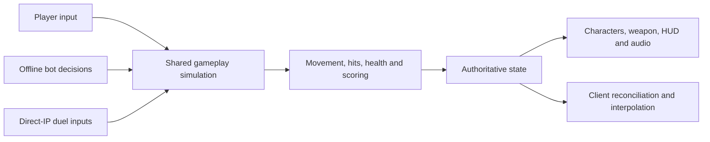

# Rail Arena

### One railgun. Every shot matters.

**An arena shooter built to make aim practice feel like play.**

Rail Arena is a Windows game and AI engineering portfolio project by **Sanders Riddle**, built with modern AI agentic workflows. The vision is a complete, focused aim trainer and arena game: sharpen your precision, learn to shoot while moving, and turn another practice session into one more match.

[Explore the vision](#the-game) · [Build and play](docs/BUILD-AND-PLAY.md) · [Character designs](docs/CHARACTER-REFERENCES.md) · [Engineering evidence](docs/VALIDATION.md)

> **Playable development project.** Offline practice, bot matches and direct-IP duel integration are implemented. Final presentation, human playtesting and internet multiplayer acceptance remain in progress. There is no finished downloadable release yet. The banner and character artwork are concept references.

## The game

Aim is more interesting when the target shoots back.

Rail Arena puts precision inside a compact sci-fi arena: elevated platforms, momentum-driven movement, jump pads and a railgun that rewards a well-timed shot. Practice at your own pace, fight bots, or work toward a head-to-head duel where positioning matters as much as your crosshair.

The design draws on Quake III Arena's movement and Unreal Tournament's arena readability, with original characters, weapons and environments. Its identity is deliberately focused: **one weapon, a readable battlefield, and skill you can feel improving.**

| Experience | What it is for |
| --- | --- |
| **Solo practice** | Explore the arena, learn routes and work on movement with unlimited respawns and no opponents. |
| **Target practice** | Use stationary, moving or combat bot behavior to isolate precision or practice under pressure. |
| **Bot matches** | Face 1–7 bots across three difficulty levels in timed matches with scoring, results and restart. |
| **Direct-IP duel** | Host or join a two-human match, ready up, compete and rematch. Integration is implemented; full human and remote-network acceptance is still open. |

### Precision with consequences

- **Make the shot count.** Unlimited ammunition, a 1.5-second rail cycle and location-based damage: 100 to the head, 50 to the body, 34 to a limb.
- **Keep moving.** Ground acceleration, air control and momentum preservation support a movement-driven practice loop, without sprint or stamina.
- **Play the arena.** Ramps, gaps, four jump pads and contested health pickups create routes and decisions beyond holding an angle.
- **Stay in the loop.** Untimed practice supports repetition; ten-minute matches add a countdown, scoreboard, results and tied-leader sudden death.

The goal is enjoyable, repeatable practice inside a real game. Claims about measurable aim improvement require player studies; this project does not yet establish training outcomes.

### A complete game with a deliberate boundary

The first-version target is **one polished original arena, one satisfying railgun, offline practice and bot combat, and a complete two-human direct-IP duel loop**. Responsive controls, readable feedback, dependable shutdown and a clean path from launch to rematch are part of that target.

Cloud accounts, matchmaking services, progression economies, monetization, extra weapons, spectators and online bots are outside this version's scope. See the [full gameplay and completion contract](docs/OBJECTIVE.md).

## Designed to be recognizable

Ivory armor. Graphite silhouettes. Cyan energy. Distinct contenders built around a high-detail, low-poly visual direction.


| Contender | Visual identity | Reference sheet |
| --- | --- | --- |
| **Player** | Ivory armor, teal cowl and cyan accents | [Turnaround](ArtSource/Original/StylizedContenders/References-v1/Final/Player-Turnaround.png) |
| **Bot 01** | Terracotta armor and amber energy | [Turnaround](ArtSource/Original/StylizedContenders/References-v1/Final/Bot01-Turnaround.png) |
| **Bot 02** | Slate, ivory and cool teal | [Turnaround](ArtSource/Original/StylizedContenders/References-v1/Final/Bot02-Turnaround.png) |
| **Bot 03** | Plum armor and copper detailing | [Turnaround](ArtSource/Original/StylizedContenders/References-v1/Final/Bot03-Turnaround.png) |

[Explore all sixteen character sheets](docs/CHARACTER-REFERENCES.md), including head studies, equipment details and top/bottom concepts. These guide modeling; they are not screenshots or a promise of final runtime appearance. Newly extended hidden surfaces remain review candidates, and geometric consistency must be resolved in the shared 3D models.

The [brand kit](docs/branding/README.md) includes the transparent logo, banner, palette and usage notes.

## AI engineering, applied to a playable product

**Created by Sanders Riddle as a portfolio project in AI Solutions and AI Engineering.** Rail Arena explores how modern AI agents can help turn a creative brief into working software, editable assets and inspectable evidence.

The engineering challenge spans gameplay rules, real-time networking, asset pipelines, process lifecycle management and validation. The value of the workflow is in connecting those pieces into a maintainable product, then checking that the result behaves as intended.

| Workflow | How it appears in this project |
| --- | --- |
| **Define the contract** | Explicit gameplay rules, version pins, scope boundaries and completion criteria give agents concrete constraints. |
| **Implement and integrate** | Agent-assisted C# development and scripted asset pipelines connect simulation, bots, networking and presentation. |
| **Create and refine assets** | AI-generated concept references support visual exploration; editable Blender sources and Unity assets support implementation. Concept approval and model quality remain separate decisions. |
| **Verify with evidence** | Automated mechanics checks, standalone runners, network scenarios and build-specific reports make results reviewable. |
| **Keep the operator in control** | Project instructions require headless Unity work by default, permission before visible windows, bounded processes and cleanup. |

AI assistance is part of the development process. In-game opponents use configurable gameplay logic; they are not LLM-driven agents. Generated output is reviewed and tested, and automated checks do not substitute for human judgment about fun, feel or visual quality.

## Built for inspection

**Unity 6000.6.7f1 · URP 17.6.0 · C# · Windows keyboard and mouse · Git LFS**

The gameplay core runs at **60 ticks per second**. Offline play uses local authority; online duels use host authority with client prediction, reconciliation, opponent interpolation and bounded hit rewind up to 200 ms.



Gameplay authority determines damage and movement. Presentation observes state. Keeping those responsibilities separate makes rules easier to test and allows practice and competitive modes to share the same foundation.

Explore the [implementation record](docs/IMPLEMENTATION.md), [networking](docs/NETWORKING.md), [bot tuning](docs/BOT-TUNING.md), [weapon pipeline](docs/WEAPONS.md) and [combat feedback](docs/COMBAT-FEEDBACK.md).

### What the evidence establishes

Automated coverage includes simulation rules, standalone combat mechanics, bot scenarios, replicated respawn behavior, local duel/rematch scenarios and simulated network impairment. Reports identify the builds and conditions they cover.

The remaining quality gates include physical keyboard/mouse feel, sound-on review, final art and animation polish, native two-human play from hosting through rematch, and a duel across real internet connections. Some impaired-network runs exposed large client corrections under concurrent import/build load; smooth multiplayer remains a quality target.

**Passing tests is evidence of specific behavior, not a finished-game claim.** Read the [validation record](docs/VALIDATION.md), [acceptance matrix](docs/ACCEPTANCE.md) and [native input review](docs/NATIVE-INPUT-REVIEW.md) for results and limits.

## Build it. Play it. Inspect it.

The repository contains the editable Unity project and source assets. Windows builds are currently local and are not included as public release downloads.

```powershell
git lfs install
git clone https://github.com/Evekiio/rail-arena.git
cd rail-arena
git lfs pull
```

Use **Unity 6000.6.7f1** with Windows build support and open the `RailArena` subfolder. Unity licensing and the initial package restore are required for development. Follow the [build and play guide](docs/BUILD-AND-PLAY.md) for exact steps, or the [evaluation guide](docs/EVALUATION.md) for a focused playtest. Automation should follow the repository's [headless execution instructions](AGENTS.md).

On the development PC, the non-development evaluation player is `Builds/Evaluation/RailArena.exe`; keep its adjacent data and DLLs together. Choose **PRACTICE** for solo or bot training, **OFFLINE BOT MATCH** for a timed session, or **ONLINE DUEL // DIRECT IP** for host/join. Offline play needs no account or external service. [Direct-IP setup](docs/HOSTING.md) covers ports, firewall and hosting requirements.

| Control | Action |
| --- | --- |
| W A S D | Move |
| Mouse | Aim |
| Left mouse | Fire |
| Space | Jump; hold to keep hopping |
| Tab | Hold scoreboard |
| Escape | Pause and settings |

Choose **QUIT** to exit. **MAIN MENU** and **DISCONNECT** return to menus while keeping the application open. See [shutdown behavior](docs/SHUTDOWN.md) for lifecycle checks and runner safeguards.

## Project notes

- **Creator:** Sanders Riddle
- **Portfolio focus:** AI Solutions / AI Engineering, agentic development workflows, gameplay systems and reproducible validation
- **Status:** Active development toward a complete Windows aim trainer and arena game
- **Source:** [Evekiio/rail-arena](https://github.com/Evekiio/rail-arena)
- **License:** Original project code is [MIT licensed](LICENSE); see [third-party notices](THIRD-PARTY-NOTICES.md) for assets and dependencies.

Rail Arena uses original project assets and documented dependencies. No Quake or Unreal maps, characters, sounds, branding or code are bundled.
